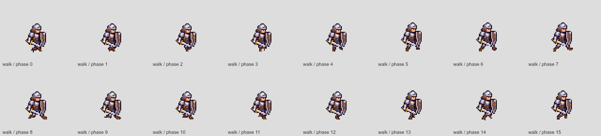

# Knight walking review — 11 November 2026

The player reported jitter on Knight; other heroes had not been tried. This pass targets Knight's actual stride and the movement clock shared by the roster. Character identity, equipment, portraits, movement speed and combat timing stay consistent with the approved game.

## Diagnosis

The previous eight-pose Knight walk repeated bunched leg positions between abruptly wider contacts. Additional material warps moved armour details but did not supply the missing leg motion. Fixed canvas registration was already correct: the approved frames reconstruct to 80×64 with their ground anchor at y56.

The runtime also used one clock for rest and travel, with a minimum walking rate of 0.6 times base speed. At roughly 15% stick input, Knight travelled about 9.5 pixels per second while still advancing about 9.3 walk poses per second. Pressing into a wall advanced the walk despite zero displacement. Rest changed the phase at which the next walk resumed.

## Changes

- Replace Knight's eight uneven poses with sixteen connected stride poses generated from his retained original leg textures. The supporting sole travels backward; the returning leg lifts and reaches forward. A 0.54-second cycle suits the existing brisk movement speed.
- Preserve the exact approved native head, armour and equipment detail with a controlled one-pixel weight shift. Repeated fractional resampling no longer changes that texture between poses.
- Rebuild all 288 Knight moving-attack combinations over the new gait. Resting art, stationary attacks, portraits and the other twenty hero sheets remain unchanged.
- Separate resting and walking clocks. Advance the gait from actual distance after collision resolution, with no minimum stepping speed. Steering intent and attack mechanics retain their existing semantics.
- A blocked hero rests and emits no walking dust or footsteps. Ice sliding and airborne leaps do not advance a ground walk.
- The hero selection stage uses the same movement clock as gameplay.
- Extend the real-game capture tool with right/left/diagonal travel, stop/restart, slow input, and moving field/crypt combat at 30 fps. Package chronological PNG sheets and correctly timed comparison GIFs.
- Paginate the attack review tool beyond eight gait columns so longer cycles cannot silently clip the second half of the review images.

## Review evidence

Two independent subagents reviewed the runtime and visual integration. The art review inspected all sixteen travel poses and all 288 moving-attack combinations on contrasting terrain, found a detached export fringe, and verified its removal. The gait has brief airborne intervals and reads as a brisk jog at normal game speed. Tests establish integration; chronological source and Game images establish the visual review.

Pre-edit native Game captures for Knight, Footman, Ranger and Sorcerer are retained in `output/walk-review-2026-11-11/before/`. Each contains the real Game, Player, sprite builder, camera, lighting and HUD, with an in-memory profile. Exact pre-edit packed sheets are in `output/walk-review-2026-11-11/source/`. These generated files are intentionally ignored by Git.

The final Knight take is `output/walk-review-2026-11-11/final/`: 756 native 480×300 frames at 60 fps, zero clipping, complete cycles in both directions and diagonally, stop/restart, gentle input, and moving field/crypt attacks. The `*-comparison.gif` files compare the prior game capture with the corrected one using each recording's real time. `coverage.json` and per-frame `samples.json` retain frame indices and movement clocks. `runtime-only/` and `draft1/` are intermediate evidence; the latter predates the final fringe correction and is superseded.

The final decoded frame fingerprint is `42776ce1e81226f53257f6d540a34ff2cd651e742fbf02b2eac05d205513c9a0`. The packed Knight file SHA-256 is `b7eb275c3f022b17b544d43ad54345f14a72ae366c0727a4ee02ef8f871ce721`.

The local comparison server accepts `WALK_BASELINE=output/walk-review-2026-11-11/source`; open `http://127.0.0.1:3016/?before=previous` to compare those sheets with the current production sheets. Both panes run the current production movement code. The saved pre-edit captures remain the reference for the original runtime behavior.

Browser automation could not open the local preview: the in-app browser timed out, and native browser control stopped because it could not establish the current URL. Visual evidence therefore comes from native Canvas recordings of the real game, not a claimed successful interactive browser session.

## Validation

- Full existing suite: **946/946 passed**, including four new runtime regressions. Server integration tests required loopback access outside the default sandbox.
- Three subsequently added Knight gait/source regressions: **3/3 passed** separately, bringing the suite to 949 tests.
- A full deterministic rebuild reproduced all twenty-one packed sheets byte for byte. Only Knight's sheet differs from the pre-edit version.
- Existing facing, terrain, crypt-strike and hero-selection checks passed; no changes to movement speed, attack release timing or damage were needed.
